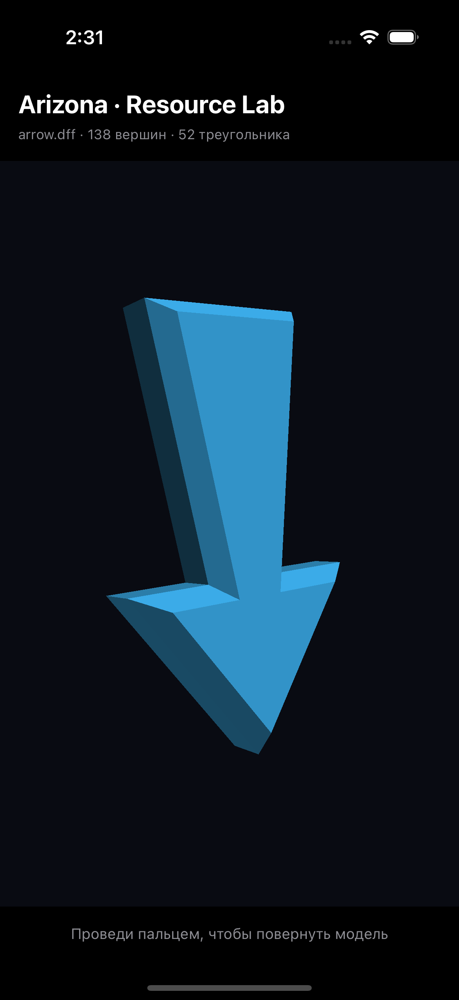

# arizona-ios — Resource Lab

Первый прототип исследования ресурсов Arizona Mobile: SwiftUI + Metal, одна модель из кэша, поворот пальцем. Это начало работы с ресурсами, не готовый игровой клиент.

## GitHub Actions

Проверено 4 ноября 2026 года в [Actions 41846474876](https://github.com/kup3r/arizona-ios/actions/runs/41846474876): Release-сборка для iPhone прошла, UI-тест в симуляторе iPhone 16 Pro прошёл — 1 тест, 0 ошибок. Использованы Xcode 16.4 и XcodeGen 2.46.0. Проверены загрузка модели и Metal pipeline, жест поворота и повторный запуск. Скриншот проверен визуально: модель действительно видна.



Репозиторий публичный; используется стандартный `macos-15-intel`, бесплатный для публичных репозиториев. Лимит расходов аккаунта не увеличивался. Первоначальный запуск приватного репозитория был остановлен GitHub до старта из-за ограничения оплаты/бюджета.

На каждый push в main, pull request и ручной запуск запускается `iOS build and simulator check`:

1. На macOS создаётся проект Xcode через XcodeGen.
2. Собирается Release-приложение для iPhone без подписи.
3. В iPhone Simulator проверяются загрузка модели, создание Metal pipeline, жест и повторный запуск приложения.
4. Сохраняются неподписанная IPA, логи, результаты XCTest и скриншоты. IPA выгружается до тестов, чтобы задержка симулятора не мешала получить готовую сборку.

Открыть **Actions → нужный запуск → Artifacts**. Файл `iPhone-unsigned-…` содержит `ArizonaResourceLab-unsigned.ipa`. Он не устанавливается на обычный iPhone без подходящей подписи. Apple-сертификаты и provisioning profile в проект не добавлялись. TestFlight этим workflow не настраивается.

Сборка и результат UI-теста проверяются по фактическому запуску Actions. Даже зелёный тест не заменяет проверку на физическом iPhone и не подтверждает совместимость с серверами Arizona.

## Локально на Mac

Установить Xcode и XcodeGen, затем:

```sh
xcodegen generate
open ArizonaResourceLab.xcodeproj
```

Для запуска на своём устройстве выбрать свою Team в Signing & Capabilities. При необходимости изменить Bundle Identifier.

## Состав

- `Sources/` — собственная оболочка и рендерер.
- `Resources/mesh.json` — статически извлечённая геометрия `engine_common.zip/arrow.dff`: 138 вершин, 52 треугольника.
- `Resources/arrow.obj` — дополнительный экспорт, в приложение не включён.
- `Tests/` — UI-проверка загрузки ресурсов и запуска.

Исходный APK и его нативные библиотеки не запускаются и в репозиторий не включены. Полный кэш тоже не включён. Геометрия сохраняет права её владельцев; код оболочки не является исходниками Arizona/GTA. Общая лицензия на сторонние материалы здесь не объявляется.

Следующие задачи: импорт материалов/текстур `.aetex`, затем маленькая сцена. Игровая логика, физика, анимация и сетевой протокол ещё отсутствуют.
